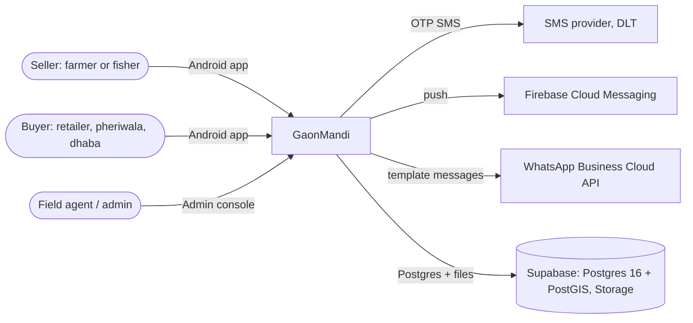
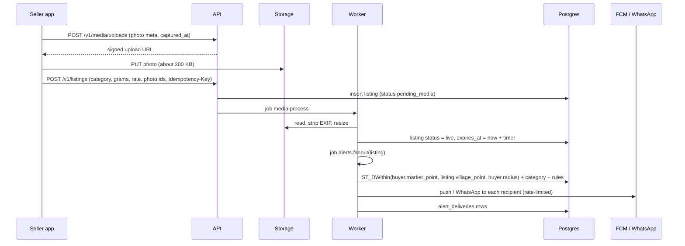

# GaonMandi architecture

This document shows how the system fits together. Product rules are in [`../PRD.md`](../PRD.md), data and API details in [`../BACKEND_PLAN.md`](../BACKEND_PLAN.md), and decisions in [`DECISIONS.md`](DECISIONS.md).

## 1. System context

GaonMandi never connects to a bank, payment gateway or wallet (ADR-007).

## 2. Containers

| Container | Tech | Responsibility |
|---|---|---|
| `apps/mobile` | React Native CLI, TypeScript | Seller and buyer app: sign-in, listing flow with camera, outbox, feed, bids, calls, deals, notifications |
| `apps/admin` | Next.js (App Router) | Staff console: buyer verification, moderation, cluster setup, reference prices, pilot dashboard |
| `apps/api` | Fastify 5, Zod | HTTP API `/v1`: auth, profiles, listings, media upload URLs, bids, deals, reports, admin routes |
| `apps/worker` | pg-boss | Jobs: media processing, alert fan-out, expiry, reminders, metric roll-ups, retention purge |
| Postgres 16 + PostGIS | Supabase (local: native install) | All data; radius queries; job queue |
| Object storage | Supabase Storage via S3 API (local: MinIO) | Listing photos, voice notes, profile photos |

## 3. Shared packages

| Package | Holds | May depend on |
|---|---|---|
| `packages/rules` | Pure product rules: alert matching, freshness, bid validation, deal states, price realization, metrics | `packages/format` only |
| `packages/geo` | Distance, rounding to km, village snapping, radius helpers (pure) | nothing |
| `packages/contracts` | Zod schemas → OpenAPI → typed client for mobile and admin | nothing app-specific |
| `packages/db` | Schema, SQL migrations, RLS policies, seed from the golden fixture, `withUserTx` | `rules`, `geo` |
| `packages/format` | ₹ and paise, kg and quintal, IST dates, Hindi relative times | nothing |
| `packages/i18n` | Hindi and English strings, plural rules | nothing |
| `packages/notify` | Push, WhatsApp and SMS adapters, templates, fakes | `format`, `i18n` |
| `packages/media` | Image resize, EXIF strip, capture-time check, audio limits | nothing |
| `packages/ui-tokens` | Design tokens for mobile and admin, generated from `design/tokens.json` | nothing |
| `packages/observability` | Logger with redaction of phone numbers and names; tracing | nothing |

## 4. Key flows

### 4.1 Publish a listing and alert buyers

Target: p95 under 60 s from publish to push delivered.

### 4.2 Bid, call and deal
1. Buyer `POST /v1/listings/:id/bids` → the API checks the rules (verified, live listing, one active bid, rate > 0) → the seller gets a push.
2. Buyer taps **Call** → `POST /v1/listings/:id/contact` logs a contact event and returns the seller's number only if the buyer is verified and the seller allows calls.
3. Seller `POST /v1/bids/:id/accept` → the listing becomes `deal_agreed`, a `deals` row is created, other bids close, and the other bidders get a push.
4. Either side `POST /v1/deals/:id/picked-up`; the seller optionally sends the final rate; both send feedback.

### 4.3 Expiry
pg-boss cron runs `listings.expire` every minute: listings past `expires_at` become `expired`, open bids close, and the seller gets a "list again?" push. The job is idempotent.

### 4.4 Offline outbox (mobile)
A listing is saved on the phone first (photos plus form), then sent by a background task with retries and an idempotency key. The server never creates two listings for one key.

## 5. Data ownership and privacy
- Public within the radius: live listings with village, rounded distance, photos, seller name and face photo (verified buyers only).
- Private to the parties: bids (seller and bidder), deals, contact events, feedback.
- Private to the user: phone number, exact GPS, devices, notification settings.
- Staff only: reports, verification notes, audit log.

## 6. Dependency rules (checked in CI)
- `apps/mobile` and `apps/admin` import only `contracts`, `format`, `i18n`, `ui-tokens` and `geo`. Never `db`, `notify` or server code.
- `packages/rules` and `packages/geo` have no I/O: no database, network, clock or random calls (time is passed in).
- Only `apps/worker` sends notifications in bulk; the API may send single transactional messages through `packages/notify`.
- SQL lives only in `packages/db` and in module `repo.ts` files.
- No module imports another module's internals; modules talk through services or jobs.

## 7. Environments
| Env | Database | Notifications | Purpose |
|---|---|---|---|
| local | Native Postgres 16 + PostGIS, MinIO binary | Fakes (logged) | Development and tests |
| dev | Supabase project (dev) | FCM test app, WhatsApp sandbox, SMS to whitelisted numbers | Team testing on real phones |
| pilot | Supabase project (prod, Mumbai) | Real FCM, approved WhatsApp templates, DLT SMS | The 60-day pilot |

## 8. Scale assumptions
Pilot: about 50 buyers, 300 sellers, under 200 listings a day, under 10,000 alerts a day. The design (PostGIS index, pg-boss, one API instance) comfortably handles 100× that. Revisit fan-out batching above 1 million alerts a day.
